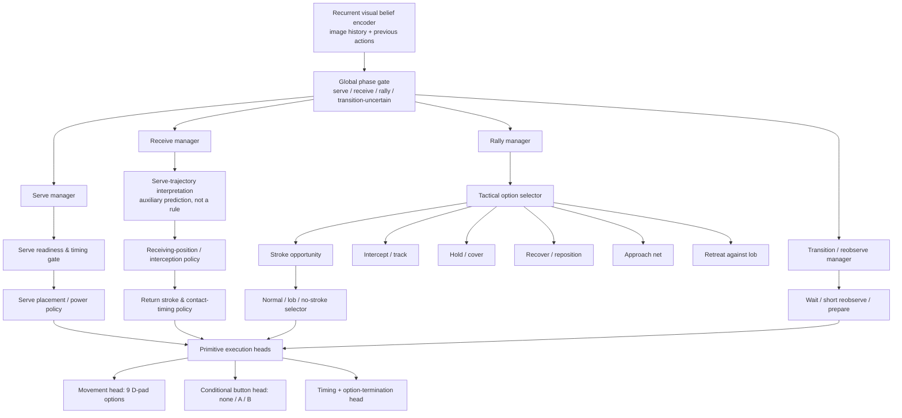

# NES Tennis: Discriminative Hierarchical Policy Blueprint

Status: the staged hierarchical implementation described here is now present in this repository. Unit and synthetic pipeline tests pass, but real-ROM playing strength remains unvalidated until the configured MesenCE executable runs and held-out NES Tennis matches are evaluated. Synthetic task labels and metrics must not be interpreted as real-game skill.

## Executive decision

Use a **shared recurrent visual-belief encoder, a learned four-way phase gate, branch-specific tactical managers, and small leaf policies with factorized action/timing heads**. This is a hierarchy of decisions, not a separate neural network for every state-grid cell.

Recommended maximum inference path:

1. **Belief encoder (not a policy):** infer ball/player state, likely turn, contact timing, uncertainty, and recent action consequences from a persistent frame history.
2. **Global phase gate:** choose `serve`, `receive`, `rally`, or `transition/uncertain`.
3. **Branch-specific manager:** select a task within the chosen phase.
4. **Leaf policy:** choose movement, shot/button, and when to reconsider the choice.

The branches need not all have equal depth. A serve can go straight from its manager to a timing/placement policy; rally play can go through a tactical selector before reaching a movement or stroke expert. Add another decision layer only when validation demonstrates a recurring confusion that the additional gate resolves.

At inference, **all gates are learned policies**. No fixed if/else routing based on RAM, screen coordinates, score, ball direction, or rules is allowed. Trusted emulator state may be used as a training label or a validated input feature, but must not directly choose an expert at inference.

## 1. Decision tree

`Transition/uncertain` is not a claim that the point is over; it is a learned route that can choose a short neutral action to gather another observation when the belief is ambiguous. The transition gate should be trained with examples of actual between-point states, CPU-turn intervals, and visually ambiguous cases.

## 2. Exact discriminations by node

### 2.1 Belief encoder and state-prediction heads

**Architecture:** per-frame CNN/ResNet stem, temporal aggregation over a sliding history, and a persistent GRU (initial target 256 hidden units). Keep the GRU hidden state across decisions and reset it only at true environment episode boundaries. The existing four-frame stacked CNN is not enough memory for long ball trajectories by itself.

**Continuous estimates:** normalized ball and player coordinates; ball displacement/velocity; estimated time-to-contact; uncertainty for each estimate; optionally opponent position and relative reachability.

**Event estimates:** agent serving, opponent serving, ball in play, ball travelling toward the agent, ball travelling away, opponent-contact window, agent-contact window, ball is a high/floating lob, point-resolved, uncertain/occluded. These are learned predictions; they do not dispatch models directly.

**Loss:** masked Smooth-L1 or Gaussian negative log-likelihood for coordinates/velocity/time-to-contact; class-balanced cross-entropy for events; calibration loss/metrics for confidence. Never use pixel-motion centroid as a ball label. If emulator RAM addresses are used to make labels, validate them against displayed frames first and keep them as labels/features—not hand-written router conditions.

### 2.2 Level 1: global phase gate

Four outputs:

- `serve`: the agent is preparing to initiate its serve or is in the serve execution window.
- `receive`: the CPU serve is underway and the agent must receive it.
- `rally`: ordinary rally decisions, including positioning and stroke choice.
- `transition_uncertain`: point transition, recovery/ready state, or enough uncertainty to prefer a short observation interval.

The label describes **what decision problem is active**, not which action is correct. The gate sees belief features, recent action, previous option and time since its invocation. It gets its own calibrated classifier loss plus hierarchical-policy return. At training time it may be teacher-forced from verified labels, followed by scheduled sampling of its own predictions. At inference it always chooses from its learned distribution.

### 2.3 Level 2: phase-specific managers

#### Serve manager

Discriminations: not-ready vs ready; wait vs initiate now; contact/press window early vs appropriate vs late; placement/power choice; recover after serving vs maintain coverage.

Leaf policy outputs the actual joint controller action. Do not create separate networks for every target lane or power combination: placement and power depend on continuous state and should generalize.

Losses: supervised timing/placement loss on verified demonstration labels; PPO objective from fault, valid-serve and eventual point outcome; auxiliary classification for serve initiated / legal serve / fault. A legal serve is a useful intermediate result, but it is not equivalent to winning the point.

#### Receive manager

Discriminations: fast vs slower serve; left/centre/right arrival lane; low/ordinary/high trajectory; imminent vs not-yet-imminent contact; move now vs stay/adjust; normal return vs lob vs no swing; return contact timing.

Represent speed, lane, and predicted arrival as continuous estimates first. Coarse bins are for reporting and balanced sampling, not for hard-coded routing. The tactical manager conditions on these features and learns how to combine them.

Losses: state-estimation losses, receiving-action behavior cloning, contact/return event loss, and PPO return. Reward a verified legal return/rally continuation as an intermediate outcome; retain the point result as the longer-horizon objective.

#### Rally manager

Discriminations, selected from learned belief rather than rules:

- agent needs to intercept an incoming ball;
- ball is on the opponent's side / CPU turn, so immediate chasing or swinging is likely unnecessary;
- maintain or improve court coverage;
- approach the net because the resulting state may be advantageous;
- retreat or turn back after a lob/high trajectory;
- recover after the agent's stroke;
- execute a stroke now versus continue observing/moving;
- the ball/state is uncertain enough to wait briefly.

The model may choose any option in any visually similar situation. These are labels for the training dataset and outputs of learned gates—not hand-coded state-to-option mappings.

#### Transition manager

Discriminations: wait neutrally, maintain position, take a small recovery action, or reobserve quickly. Training must include hard negatives: CPU is playing; ball has already crossed away from the player; the agent has just returned a shot; the point has ended; and a movement that looks plausible but worsens recovery. This branch is how the agent learns that **not moving** can be better than moving.

### 2.4 Level 3: specialist leaf policies

Each leaf receives belief features plus its own small task-specific adapter/trunk and independent critic. Share the early visual stem to conserve data and GPU memory; keep separate policy heads, critics, and (at least initially) small adapters per specialist. Promote a branch to a separate encoder only if a held-out interference test shows that sharing harms one skill.

- **Interception/track:** movement distribution over 9 D-pad choices; auxiliary prediction of a reachable meeting region/time. Train on successful and failed interception examples, not just winning points.
- **Hold/cover:** movement choices including `NO_MOVE`; learn whether moving improves future return. Use contrastive near-pairs: same broad state with ball going toward the agent vs away, and player at the useful position vs out of position.
- **Approach net:** movement choices conditioned on opponent/ball state; reward only outcomes measurable from the game or a learned value difference. No fixed “go to the net” bonus.
- **Recover/reposition:** movement choices after the agent has played a stroke; distinguish immediate interception urgency from time available to restore coverage.
- **Retreat versus lob:** movement choices conditioned on the observed high/floating trajectory and time-to-contact. Do not label every high ball as a lob without validating the cue.
- **Stroke selector:** categorical `none / A / B`, conditioned on the believed contact window, speed/trajectory, player position and opponent position. A is the normal/serve button, B the lob button according to this repo's action map.
- **Stroke execution/timing:** conditional controller action and button pulse/hold timing. The current 27-action mapping couples D-pad direction and button choice, and the bridge applies a controller state for `frame_skip` frames. For accurate timing, extend the bridge to represent movement duration separately from A/B pulse duration (including press/release edges); otherwise the policy may be unable to express a brief shot press while continuing to move.

Use a conditional action distribution, e.g. `P(move|z,task) * P(button|z,task,move)`, plus explicit button-pulse and movement durations. This preserves interactions rather than assuming the movement and shot decisions are independent. A learned termination head decides whether to continue a skill or return to a manager; duration buckets are a safety fallback, not the only way to switch.

## 3. Exhaustive scenario axes

This is an exhaustive *factorization of decisions*. Do not materialize every Cartesian-product combination as its own policy: the product is too large and many combinations are rare. Use continuous features for control and categorical strata for coverage reports and sampler quotas.

### A. Point-start context (existing, enumerable)

- Role: agent serves / CPU serves.
- Score: all 18 reachable tennis point-score pairs for each role = 36 point-start cells.
- Score strata: opening, build-up, game point for/against, deuce, advantage for/against; combined with role and deuce/ad court yields the existing 20 strata.
- Court: deuce/ad side.
- Difficulty: every available NES CPU level.

Keep score/role as optional validated input features and training labels. Do not train a distinct network for each score cell.

### B. Temporal/turn context

- Serve-ready, serve initiation, ball entering play.
- CPU serving; serve travelling; serve approaching receiver; receiving/contact window; first return.
- Agent stroke just completed; ball travelling away from agent; CPU preparing/striking; CPU ball travelling toward agent.
- Rally early/middle/late (from event history, not merely “steps until point end” for live inference).
- High/floating ball/lob; normal flatter shot; trajectory apex/descending; ball crossing net.
- Point resolved, between points, reset uncertainty.

### C. Ball context

- Horizontal lane: left / centre / right, used as a sampling bin while preserving continuous x/velocity.
- Court depth / expected landing zone: short / middle / deep, again with continuous location.
- Trajectory height/profile: low/ordinary/high-floater when visually supportable.
- Speed: empirical slow / medium / fast quantiles from the observed game data.
- Motion: toward player / away from player / lateral / uncertain.
- Time to contact: urgent / soon / not imminent, plus continuous regression.
- Reachability: likely reachable without adjustment / reachable after movement / probably missed already, with uncertainty.

### D. Player/opponent positioning

- Agent lateral position: left / centre / right.
- Agent depth: baseline / mid-court / net region.
- Opponent depth: baseline / mid-court / net region.
- Relative ball-to-player intercept offset (continuous x/y and predicted time).
- Agent movement already in progress vs stationary; just hit a ball vs has not hit recently.

These coarse bins exist to reveal coverage gaps in metrics. They must not become rigid zones that directly select actions.

### E. Choice contrasts every specialist must learn

- move left / right / diagonal / forward / back / no movement;
- move now vs wait briefly then move;
- chase an incoming ball vs maintain position while CPU has the ball;
- return now vs allow another observation;
- normal shot vs lob vs no stroke;
- early vs in-window vs late button press;
- approach net vs remain in coverage;
- retreat after a lob vs continue moving forward;
- recover immediately after one's own shot vs remain committed to intercept;
- short controller pulse vs held input;
- safe rally continuation vs aggressive option, evaluated by subsequent point outcomes rather than labels based solely on point winner.

### F. Outcome axes

Record independently where observable: serve initiated, legal serve/fault, return made/missed, contact success/miss, rally continued/ended, forced/unforced error if reliably inferable, point won/lost, game won/lost, rally length, and skill-switch sequence. Never equate match outcome with every action in the match.

## 4. Scenario sampling without combinatorial explosion

Maintain three replay pools:

1. **Natural-match pool (30–50% initially):** unmodified full points/matches, sampled from held-out-like natural play. This protects the final objective and guards against overfitting to curated segments.
2. **Task-event pool (30–50% initially):** windows around serve, receive, contact, lob, post-stroke recovery, net approach, and off-turn waiting. Sample by task and rare positive/negative outcome; do not oversample success to the point that the learned policy sees an unrealistic distribution.
3. **Stratified scenario pool (10–20% initially):** the 36 point-start cells / 20 strata, court side, difficulty and underperforming state buckets. Start these as tuneable fractions, not immutable constants.

Within each pool, sample rare strata with a capped inverse-frequency weight and a minimum floor. Keep a separate fixed natural-distribution probe set whose experiences are **never trained on**. Split by whole source match, not overlapping frames/windows.

Use balanced *contrast pairs* for discrimination: similar states that differ in one relevant factor (fast vs slow serve; inbound vs outbound ball; CPU turn vs player contact opportunity; ball high vs ordinary; player at baseline vs net; position where waiting is good vs position where movement is needed). Those pairs are far more diagnostic than only collecting “winning” and “losing” points.

## 5. Reward design: specific but not fabricated

Every expert has a local critic and task objective, but the actual point result remains the long-horizon goal.

- **Serve:** verified legal serve/fault plus point return. Do not assign “good placement” reward unless placement/outcome is measured.
- **Receive:** verified successful return/rally continuation, then point outcome.
- **Interception:** verified successful contact/return event; use supervised meeting-point labels where available.
- **Hold/cover/recovery/approach/retreat:** use future point value and verified consequences. Do not reward a coordinate (centre/baseline/net) just because it is conventionally strategic.
- **Shot selector:** verified legal stroke and rally continuation, then point result. Use forced-opponent-miss reward only if it can be labeled reliably.
- **Timing:** contact-window success/failure labels and event outcomes; no invented timing reward from image motion.
- **Managers:** semi-Markov return accumulated over the option, with duration-aware discounting and the final point outcome. Managers must not be supervised by assigning every task in a winning point as correct.

Potential-based shaping is allowed only when the potential is learned/validated against future value: `r' = r + gamma * Phi(s_next) - Phi(s)`. It should be ablated against no-shaping and point-only reward; it must not encode a hand-written preference for a court location.

## 6. Training order

1. **Validate telemetry and transitions.** Reliable point result, service role, terminal/truncation and pre-reset terminal observation. Test controller edge semantics and button durations.
2. **Annotate and split demonstrations.** Whole matches for train/validation/holdout. Manually verify a small gold set before scaling labels. Sidecars should include phase/turn, skill segments, ball/player positions, velocity/trajectory class, contact window/time-to-contact, actions, event outcomes, point result and confidence.
3. **Pretrain belief encoder.** State/event prediction on labeled frames; freeze or use a low learning rate for the encoder initially.
4. **Warm-start leaf specialists.** Behavioral cloning on task-specific segments, with task-balanced batches. Validate each leaf on held-out task metrics. Then local online PPO in matching scenario resets while the manager is teacher-forced during early training.
5. **Train phase/tactical gates.** Use annotated labels to pretrain gates, followed by scheduled exposure to model-selected routes. Train managers with semi-Markov PPO over skill returns. A DAgger-style correction pass records states where the current manager routes incorrectly and adds expert labels.
6. **Manager-only online fine-tuning.** Freeze expert actor weights at first; optimize gate/termination decisions on full point outcomes. Evaluate before unfreezing.
7. **Joint fine-tuning.** Only after independent leaf competence and stable manager routing. Use a lower shared-encoder learning rate and preserve specialist replay.
8. **Ablation.** Compare flat PPO, current seven-option hierarchy, hierarchy without task BC, and the proposed tree at matched environment steps and held-out scenarios.

Do not run all experts from scratch with the same sparse point reward and hope the tree alone solves credit assignment.

## 7. Initial data targets (starting quota, not a guarantee)

Treat these as a first data collection target and let held-out learning curves determine whether more labels are needed:

- Phase/turn gate: at least 500 labeled frames per broad phase, including hard negatives and visually ambiguous transitions.
- Ball/player state and contact prediction: 1,000+ labeled frames spread across distinct trajectories; 300+ examples around contact opportunities and near-misses. Coordinate labels should cover the full court, not just the ball's common path.
- Serve/receive: at least 300–500 segments for each role as a first pass, deliberately including legal serves, faults, fast/slow serves, left/right/deuce/ad patterns, and successful/failed returns.
- Each positioning leaf: 300+ labeled decisions, including positive and negative contrasts (especially `NO_MOVE` on CPU turns, recover vs continue forward, and approach vs hold).
- Shot/timing: 500–1,000 contact-centered examples in total as an initial pass, including A/B/no-swing, early/in-window/late presses, reachable/marginal/unreachable balls, and both points won and lost.
- High-level routing: 1,000+ task-segment starts with verified segment labels across the broad phase/task categories; ensure each branch has sufficient positive and negative examples.

These quotas are not statistical guarantees and should not all be collected before a first test. Label a pilot set, train a baseline, inspect per-class error/confusion and learning curves, then collect where the measured gaps remain.

## 8. How to decide if a branch deserves its own model

Split one model into two only if all conditions are met:

1. It has a clear, annotatable decision boundary and distinct loss or success metric.
2. The two outcomes are repeatedly confused on a held-out set or gradient/task interference is measured.
3. Each new branch has adequate positive *and* negative examples from multiple source matches.
4. The split improves held-out task performance and final point win rate at a matched environment-step budget.
5. Added router error does not wipe out the leaf's gain.

If not, retain one policy with conditional heads or a task embedding. Do not split by score cell, every ball coordinate bin, or every combination of trajectory and court zone.

## 9. Required diagnostics and promotion criteria

Log per layer and per branch:

- routing confusion matrix, calibration and route frequency;
- option lengths and early/late termination rate;
- action entropy, movement distribution, button presses, button pulse duration;
- event prediction precision/recall and time-to-contact error;
- per-task BC loss and held-out action accuracy;
- successful serve, fault, return success, contact success, missed reachable balls, unnecessary movement on opponent turn, and lob recovery success;
- points won/lost by server/receiver role, side, score pressure and difficulty;
- confidence intervals on fixed held-out points/matches.

A skill is *not* promoted because its loss decreases. It is promoted when its task metrics improve on held-out scenarios and integration does not regress full-point outcomes. Evaluate at least 100 completed points per checkpoint for screening and preferably 300–500 for more stable comparisons; use multiple seeds where feasible. Report `N/A`, not 0%, when no point completes.

## 10. What this means for the current code

The current implementation includes the root phase gate, phase-conditional skill gates, thirteen leaf specialists, a recurrent shared encoder, masked state/event prediction losses, controller button-pulse outputs, staged training, checkpoint assembly, demonstration/segment audit, and saved-state scenario evaluation. Deterministic and stochastic inference traverse the hierarchy top-down rather than taking a flat argmax over all leaves. This avoids a branch with only one available leaf winning merely because it has fewer conditional decisions.

The implementation is deliberately conservative about evidence: task labels must be explicitly annotated; broad phase labels never become leaf-action targets; unknown button pulse lengths remain masked; task-segment length is not treated as manager option duration; and point-level reward-to-go uses only recorded rewards. When point outcome is missing or a run truncates, the result is unknown rather than silently converted to a win or loss.

Still unvalidated against real gameplay: visual event/ball tracking accuracy, quality of manually recorded annotations, bridge behavior on the user's exact MesenCE build, expert win-rate contribution, and whether each branch has sufficient real-data coverage. The next empirical step is to run `scripts/check_mesen.ps1`, record diverse matches, inspect `python -m tennis_rl.dataset stats`, train stages in `STAGED_TRAINING_GUIDE.md` order, and compare held-out scenario evaluations. The deeper hierarchy is implemented software; better tennis play remains a hypothesis until those paired ROM-based evaluations confirm it.
